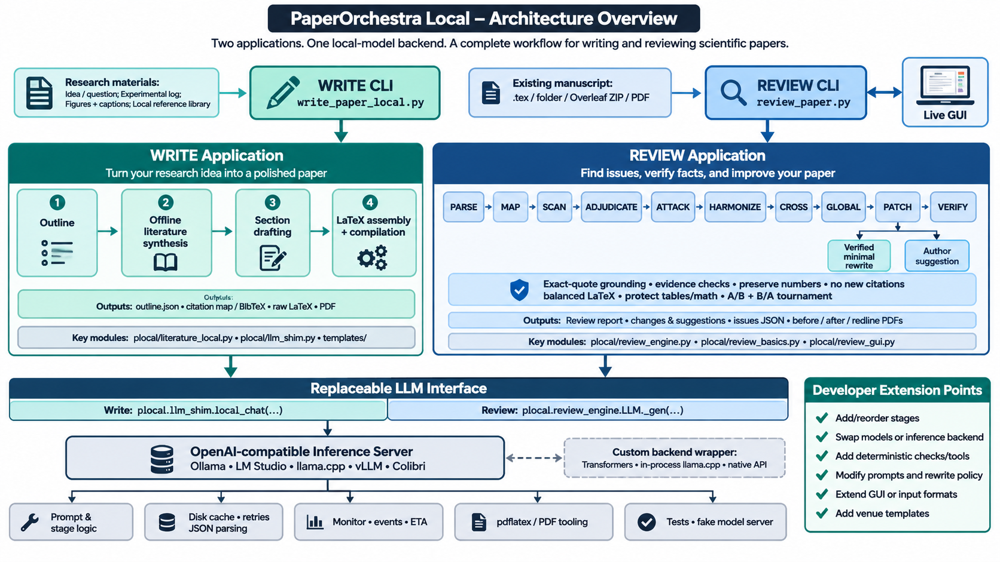

### AI made from AI and tested by AI

# PaperOrchestra Local



PaperOrchestra Local is organized around two independent but complementary applications that share a replaceable local-model inference layer. The WRITE application transforms research materials—including an initial research idea, experimental logs, figures, captions, and a local reference library—into a complete scientific manuscript through four sequential stages: outline generation, offline literature synthesis, section drafting, and LaTeX assembly and compilation. The REVIEW application accepts existing manuscripts in LaTeX, folder, Overleaf ZIP, or PDF formats and processes them through a ten-stage review pipeline: parsing, structural mapping, initial scanning, adjudication, adversarial analysis, harmonization, cross-section verification, global assessment, patch generation, and final verification. Its interactive GUI provides live monitoring, evidence visualization, document comparison, and author-controlled suggestions.

Both applications communicate with their respective LLM integration points, allowing developers to replace models and inference infrastructure without redesigning the application workflows. The default integration supports OpenAI-compatible inference servers, including Ollama, LM Studio, llama.cpp, vLLM, and Colibri. Custom backends can also be implemented through the writing application's `local_chat` interface or the review engine's `LLM._gen()` method. Supporting infrastructure provides prompt and stage management, disk caching, JSON parsing, retry handling, monitoring, event logging, execution-time estimation, and PDF compilation utilities. The architecture also exposes modular extension points for introducing new agents, deterministic verification tools, review stages, prompts, model configurations, input formats, graphical components, and publication templates. Importantly, the review pipeline enforces scientific-safety constraints: automatically accepted revisions must preserve numerical results, avoid introducing references, maintain valid LaTeX, protect tables and mathematical environments, and outperform the original text in a position-swapped comparison. Consequently, developers can independently modify the writing workflow, review methodology, graphical interface, and inference backend while retaining the existing integration contracts and verification mechanisms.

**Write and review scientific papers with local LLMs: no API keys, no cloud.**

> Unofficial add-on built on [google-research/paper-orchestra](https://github.com/google-research/paper-orchestra) (Apache-2.0).
> Not affiliated with or endorsed by Google. See [NOTICE](NOTICE).
> *Spanish version: [README.es.md](README.es.md)*

Two apps share one local-model backend (any OpenAI-compatible server: Ollama, llama.cpp, LM Studio, vLLM, colibri...):

| App | Command | What it does |
|---|---|---|
| **Write** | `python write_paper_local.py` | You give an idea + results (+ figures + a reference library). It writes the paper: outline → offline literature → full LaTeX draft → PDF. |
| **Review** | `python review_paper.py PAPER` | Works on **any** paper (`.tex`, folder, Overleaf `.zip` or a bare `.pdf`). Finds problems, **rewrites what is necessary with a justification**, keeps the rest as suggestions, and shows everything live in a GUI on top of your PDF. |

```
python review_paper.py my_paper.zip      # or .tex / folder / .pdf
python write_paper_local.py --model qwen2.5:7b-instruct
python write_paper_local.py --refine     # write, then review the draft
```

**Contents:** [Why it is different](#why-it-is-different) · [GUI](#the-control-room-gui) · [Quick start](#quick-start) · [Configure the local models](#configure-the-local-models) · [Write your own paper](#write-your-own-paper) · [Outputs](#outputs) · [Status and limits](#status-and-honest-limits) · [Developer guide](#developer-guide) · [Security](#security--privacy) · [License](#license)

## Why it is different

Small local models are weak reviewers if you just paste the paper. The review engine (**Cascade Reviewer**) compensates with systems tricks:

- **Propose cheap, verify expensive**: a small fast model screens every chunk; a bigger one only *adjudicates* contested findings. All fast work runs first, then **one** model swap (matters on 16 GB RAM).
- **Grounded critiques only**: every finding must quote the paper verbatim, verified by code. Hallucinated critiques are dropped (and counted).
- **Risk-weighted compute**: deterministic risk scores (over-claim words vs hedging, numbers not found in your results log, broken refs) decide how many adversarial "Reviewer 2" rounds a section deserves.
- **Position-swapped patch tournament**: a rewrite must beat the original in *both* A/B and B/A order.
- **Evidence binding**: numbers in the paper that appear nowhere in your results log are flagged instantly (no LLM).
- **Coherence**: after a claim is softened, the same claim is hunted in other sections (abstract / intro / conclusion) and rewritten consistently.
- **Honest ETA**: prefill/decode speeds are measured live; the dashboard shows a likely and a worst-case finish time.

### Scientific-safety guarantees (covered by tests)
A rewrite is applied only if it is *necessary* (high/medium severity, confirmed by the deep model / adversarial round / deterministic evidence) **and** keeps **exactly the same numbers**, adds **no new citations/refs**, keeps LaTeX balanced, never touches tables/math environments, and wins the tournament. Everything else stays a suggestion you can apply with one click. In PDF-only mode nothing is rewritten.

## The control-room GUI

Opens in your browser while the review runs (`--no-gui` to disable):
red word-level boxes sweeping over the text being read and over the exact words the model cites; animated arcs from each passage to **what it is compared with and how** (other sections, your results log); an attention minimap of the whole paper; a fast-vs-deep model timeline; diffs with justification; one-click suggestions; before / rewritten / redline (red-blue) PDF views. See [docs/GUI.md](docs/GUI.md).

## Quick start

Requirements: Python 3.10+, a local OpenAI-compatible server (we assume [Ollama](https://ollama.com)), and `pdflatex` (MiKTeX / TeX Live) for PDFs.

```bash
git clone https://github.com/<you>/paperorchestra-local.git
cd paperorchestra-local
python -m venv .venv && source .venv/bin/activate      # Windows: .venv\Scripts\activate
pip install -r requirements.txt
cp .env.example .env                                   # optional settings

python scripts/dry_run.py                              # 1) no model needed: checks the wiring
```

Then with a real model (Windows: `setx OLLAMA_CONTEXT_LENGTH 16384` and restart Ollama; Linux/macOS: `export OLLAMA_CONTEXT_LENGTH=16384`):

```bash
ollama pull qwen2.5:3b-instruct && ollama pull qwen2.5:7b-instruct    # or scripts/pull_models.*
python write_paper_local.py --model qwen2.5:7b-instruct --ctx 16384    # writes the example paper
python review_paper.py outputs/dummy_paper/draft_paper.pdf --fast-model qwen2.5:3b-instruct --deep-model qwen2.5:7b-instruct
```

Quick no-model preview of the GUI animations over any paper: `python review_paper.py paper.pdf --diagnostic` (or `--mock`).

## Configure the local models

Nothing is hard-wired to one model: a model is just a name string sent to an OpenAI-compatible server (`LLM_BASE_URL`).

### Where each setting lives

| Setting | Review app (`review_paper.py`) | Write app (`write_paper_local.py`) | Default in code |
|---|---|---|---|
| Server URL | `LLM_BASE_URL` (falls back to `OPENAI_BASE_URL`) | `--base_url` or `LLM_BASE_URL` (falls back to `LOCAL_LLM_BASE_URL`, `OPENAI_BASE_URL`) | `http://localhost:11434/v1` |
| Model(s) | `--fast-model` / `FAST_MODEL`, `--deep-model` / `DEEP_MODEL` | `--model` / `LOCAL_LLM_MODEL` | `qwen3:4b`, `qwen3:8b` (review) · `qwen3:8b` (write) |
| Context window | `--ctx` / `LLM_CTX` | `--ctx` / `LOCAL_LLM_CTX` | `16384` |
| Max output tokens | fixed per call in `review_engine.py` | `LOCAL_MAX_TOKENS` | `5500` (write) |
| "Thinking" off | `NO_THINK=1` | `NO_THINK=1` | on |

Precedence: **CLI flag > real environment variable > `.env` file > default in code** (the entry scripts load `.env` automatically and never override real environment variables). The code defaults are `qwen3` *reasoning* models; for CPU use we recommend non-thinking instruct models, so put this in your `.env`:

```bash
FAST_MODEL=qwen2.5:3b-instruct
DEEP_MODEL=qwen2.5:7b-instruct
LOCAL_LLM_MODEL=qwen2.5:7b-instruct
```

### Which model does what (review app)

| Model | Stages |
|---|---|
| `FAST_MODEL` | MAP (chunk summaries) and SCAN (screening of every chunk) |
| `DEEP_MODEL` | ADJUDICATE, ATTACK, HARMONIZE, CROSS, GLOBAL (+ global rewrites), the patch-tournament judge, the score panel and the executive summary |

The constants are `FAST` / `DEEP` at the top of [`plocal/review_engine.py`](plocal/review_engine.py). **Single-model machines**: set `FAST_MODEL` equal to `DEEP_MODEL`; the "model swap" step disappears.

<details><summary>Use a third model just for the tournament judge</summary>

```python
# plocal/review_engine.py, next to FAST / DEEP
JUDGE = os.getenv("JUDGE_MODEL", DEEP)

# in judge(): change  llm.call(DEEP, "You are a precise scientific editor.", ...)
#                to   llm.call(JUDGE, "You are a precise scientific editor.", ...)
```
Ollama keeps one model resident, so a third model adds model swaps (time), and the ETA model does not account for them.
</details>

### Which model does what (write app)

All upstream agents (outline, literature synthesis, section writing) share one model: `plocal.llm_shim.MODEL`. `local_chat` reads it **at call time**, so you can use a different model per stage by setting it between stages in `main()` of [`write_paper_local.py`](write_paper_local.py):

```python
local_llm_shim.MODEL = "qwen2.5:3b-instruct"   # before stage 1 (outline)
...
local_llm_shim.MODEL = "qwen2.5:14b-instruct"  # before stage 3 (section writing)
```

# Using Other Models

A model is simply a name sent to an OpenAI-compatible server. To use another model, pull it on your server (e.g., `ollama pull NAME`) and provide the exact model name to the application. You can verify available models with `ollama list`.

## 1. Quick Reference: What Do I Change?

| I want to... | Review App (`review_paper.py`) | Write App (`write_paper_local.py`) |
|---|---|---|
| Use another model | `--fast-model NAME --deep-model NAME` | `--model NAME` |
| Use only one model | Give the same name to both flags (no model-switching step) | N/A (already uses one model) |
| Make it permanent | `.env`: `FAST_MODEL=` and `DEEP_MODEL=` | `.env`: `LOCAL_LLM_MODEL=` |
| Use another server | `LLM_BASE_URL=http://host:port/v1` | `--base_url URL` or `LLM_BASE_URL` |
| Give it a bigger context window | `--ctx 32768` (+ your server's own setting) | `--ctx 32768` (+ your server's own setting) |
| Allow longer answers | Fixed per call in `review_engine.py` | `LOCAL_MAX_TOKENS=8000` |
| Stop a reasoning model from thinking | `NO_THINK=1` (default) | `NO_THINK=1` (default) |

**Configuration priority:**

Command-line flag > real environment variable > `.env` file > default in the code.

## 2. Ready-to-Copy `.env` Examples

### 16 GB Laptop, CPU Only

```env
FAST_MODEL=qwen2.5:3b-instruct
DEEP_MODEL=qwen2.5:7b-instruct
LOCAL_LLM_MODEL=qwen2.5:7b-instruct
```

### Only One Model Fits in Memory

```env
FAST_MODEL=qwen2.5:7b-instruct
DEEP_MODEL=qwen2.5:7b-instruct
```

### 32 GB RAM

```env
FAST_MODEL=qwen2.5:7b-instruct
DEEP_MODEL=qwen2.5:14b-instruct
LOCAL_LLM_MODEL=qwen2.5:14b-instruct
```

### LM Studio

```env
LLM_BASE_URL=http://localhost:1234/v1
```

Use the exact model names displayed by LM Studio for the loaded models.

### llama.cpp (`llama-server`)

```env
LLM_BASE_URL=http://localhost:8080/v1
```

The model name is usually ignored by the server. You can use any text.

### Remote OpenAI-Compatible API

```env
LLM_BASE_URL=https://your-provider/v1
OPENAI_API_KEY=your_api_key
```

**Important:** Your paper text will be sent to that provider.

The model names above are examples. Any model pulled or loaded by your server can be used.

## 3. Which Model Does Which Job? (Review App)

| Model | Stages | What It Needs to Be Good At |
|---|---|---|
| `FAST_MODEL` | MAP (summaries), SCAN (screens every chunk) | Quoting text exactly and identifying candidate problems. A small instruct model is sufficient. |
| `DEEP_MODEL` | ADJUDICATE, ATTACK, HARMONIZE, CROSS, GLOBAL, patch-tournament judge, score panel, executive summary | Determining whether a problem is real and producing faithful, minimal rewrites. Use the largest model your machine can run at a tolerable speed. |

## 4. Server URLs (Typical Defaults)

Verify the actual address and port configured on your server.

| Server | `LLM_BASE_URL` |
|---|---|
| Ollama | `http://localhost:11434/v1` |
| LM Studio | `http://localhost:1234/v1` |
| llama.cpp (`llama-server`) | `http://localhost:8080/v1` |
| vLLM | `http://localhost:8000/v1` |
| Colibri (`coli serve`) | `http://127.0.0.1:8000/v1` |

## 5. Choosing Models by Hardware

These are starting points, not benchmarked recommendations.

| Your Machine | Fast Model | Deep / Writer Model |
|---|---|---|
| 16 GB RAM, CPU | 3B–4B instruct | 7B–8B instruct (Q4) |
| 32 GB RAM | 7B–8B instruct | 14B instruct |
| GPU or 64 GB+ RAM | 8B–14B | 30B+ |

**Recommendation:** Prefer non-thinking instruct models when running on CPU. Reasoning models can spend several minutes generating internal reasoning before producing an answer. The dashboard displays a `(thinking)` phase when this happens.

## 6. Different Models for Different Jobs

### A Third Model Only for the Tournament Judge (Review App)

Edit `plocal/review_engine.py`.

Add a separate judge model near the `FAST` and `DEEP` definitions:

```python
JUDGE = os.getenv("JUDGE_MODEL", DEEP)
```

Then, inside `judge()`, replace:

```python
llm.call(DEEP, ...)
```

with:

```python
llm.call(JUDGE, ...)
```

You can now configure the third model independently:

```env
JUDGE_MODEL=your-judge-model
```

### A Small Model for the Outline and a Large Model for Section Writing (Write App)

Edit `write_paper_local.py`, inside `main()`.

Set the model before each stage:

```python
# Before stage 1
local_llm_shim.MODEL = "small-model"

# Before stage 3
local_llm_shim.MODEL = "big-model"
```

The model is read at every call, so changing it between stages works.

**Performance consideration:** Most local servers keep only one model in memory. Switching models requires loading the next model, which adds time. The dashboard's time estimate does not account for additional switches you introduce.

## 7. If Your Server Rejects Extra Request Fields

The applications send two Ollama-specific extra fields:

- `options.num_ctx`
- `reasoning_effort`

Most servers ignore unknown fields. However, if your server rejects them, use the following adjustments.

| App | Remove `options.num_ctx` | Remove `reasoning_effort` and the `/no_think` suffix |
|---|---|---|
| Review | Set `OLLAMA_OPTS=0` | Set `NO_THINK=0` |
| Write | Edit the `eb` dictionary in `local_chat()` inside `plocal/llm_shim.py` | Set `NO_THINK=0` |

## 8. Using a Model Without an OpenAI-Compatible Server

You can integrate models that do not run behind an OpenAI-compatible server, including:

- In-process llama.cpp
- Hugging Face Transformers
- Native model APIs
- Custom inference backends

Each application has one central text-generation entry point. You can replace it using a small wrapper script without modifying the repository itself.

### Integration Points

| App | Replace | Your Function Must |
|---|---|---|
| Review | Subclass `LLM` and override `_gen(...)`, then set `E.LLM = MyBackend` | Return the raw generated answer text. |
| Write | Replace `llm_shim.local_chat` with your function | Accept `(prompt, system, temperature, max_tokens, label)` and return the generated text. |

### Example: Custom Backend for Both Applications

Create `my_backend.py` and run it instead of `review_paper.py`.

```python
import time
from plocal import review_engine as E, llm_shim


def my_generate(system, user, max_tokens, temperature):
    # Call YOUR model here and return the generated text.
    ...


class MyBackend(E.LLM):

    def _gen(self, model, system, user, max_tokens,
             temperature, label, mock_ctx):

        t0 = time.time()

        self.mon.phase("generate")  # GUI: LEYENDO -> GENERANDO

        text = my_generate(
            system,
            user,
            max_tokens,
            temperature
        )

        self.mon.live(text[-700:], text)

        self.mon.observe(
            model,
            (len(system) + len(user)) / 3,
            0.0,
            len(text) / 4,
            time.time() - t0
        )

        return text


E.LLM = MyBackend


llm_shim.local_chat = lambda prompt, system=None, temperature=0.4, max_tokens=None, label="llm": \
    my_generate(
        system or "",
        prompt,
        max_tokens or 5500,
        temperature
    )


import review_paper
review_paper.main()
```

**What remains handled automatically?**

The existing `LLM.call()` implementation continues to handle:

- JSON parsing
- Three retries
- `<think>` tag stripping
- Disk caching

You only need to implement the actual model-generation function.

## 9. Common Problems When Switching Models

| Symptom | Likely Cause | Fix |
|---|---|---|
| Model not found / HTTP 404 | Model name does not match the server | Copy the exact name from `ollama list` or your server's model list. |
| Paper seems cut off or output stops early | Context window is too small | Increase `--ctx` and the server's context setting (e.g., `OLLAMA_CONTEXT_LENGTH`). |
| Stays on `LEYENDO` or `(thinking)` for minutes | Reasoning model or excessively long prompt for your CPU | Use a non-thinking instruct model, reduce `SECTION_CHARS`, and check `ollama ps`. |
| Many parsing failures / invalid JSON or LaTeX | Model is too small for the task | Use a larger deep/writer model, increase `--ctx`, and rerun with `--resume` (Write App). |
| New model produces the same answers as the old one | Potentially cached results | The cache is keyed by model + prompt, so different models should have separate entries. To force a completely fresh run, delete `<output>/.cache/`. |

---

**Final note:** Both applications are designed to work with different local inference servers and models. You are not locked into Ollama, a particular model family, or a specific hardware configuration. As long as you provide a compatible backend or implement the custom generation wrapper, you can adapt the system to your available infrastructure.

### Other servers

| Server | Typical URL (check yours) |
|---|---|
| Ollama | `http://localhost:11434/v1` |
| LM Studio | `http://localhost:1234/v1` |
| llama.cpp `llama-server` | `http://localhost:8080/v1` |
| vLLM | `http://localhost:8000/v1` |
| colibri `coli serve` | `http://127.0.0.1:8000/v1` |
| Any remote OpenAI-compatible API | set `LLM_BASE_URL` and `OPENAI_API_KEY` (this sends your text to that provider) |

The apps also send Ollama-specific fields: `options.num_ctx` and `reasoning_effort`. Most servers ignore unknown fields. If yours rejects them: in the review app set `OLLAMA_OPTS=0` (drops `options`) and `NO_THINK=0` (drops `reasoning_effort` and the `/no_think` suffix); in the write app edit the `eb` dict in `local_chat()` in [`plocal/llm_shim.py`](plocal/llm_shim.py).

### A backend that is not OpenAI-compatible (in-process llama.cpp, transformers, native APIs...)

There is one seam per app. Replace it from a small wrapper script (no need to edit the repo):

```python
# my_backend.py  (run it instead of review_paper.py / write_paper_local.py)
import time
from plocal import review_engine as E, llm_shim

def my_generate(system, user, max_tokens, temperature):
    ...  # call YOUR model here and return the text

class MyBackend(E.LLM):                      # review app: only _gen needs to change
    def _gen(self, model, system, user, max_tokens, temperature, label, mock_ctx):
        t0 = time.time()
        self.mon.phase("generate")           # GUI phase: LEYENDO -> GENERANDO
        text = my_generate(system, user, max_tokens, temperature)
        self.mon.live(text[-700:], text)     # live text + red boxes on cited quotes in the GUI
        self.mon.observe(model, (len(system) + len(user)) / 3, 0.0, len(text) / 4, time.time() - t0)  # feeds the ETA
        return text
E.LLM = MyBackend

# write app: every upstream agent funnels through this one function
llm_shim.local_chat = lambda prompt, system=None, temperature=0.4, max_tokens=None, label="llm": \
    my_generate(system or "", prompt, max_tokens or 5500, temperature)

import review_paper                          # or: import write_paper_local as w; w.main()
review_paper.main()
```

Contract of `_gen`: return the raw text; JSON parsing, the 3 retries, `<think>` stripping and the disk cache are done by `LLM.call()`. If your backend streams, call `self.mon.live(tail, full)` as text arrives to get the live GUI effects.

## Write your own paper

Put four things in a folder (see [`examples/dummy_paper/`](examples/dummy_paper/)): `idea_sparse.md`, `experimental_log.md`, `figures/` (+ `info.json` captions) and `local_literature.json` (the references the paper may cite; it never invents references). Then:

```bash
python write_paper_local.py --raw_materials_dir MY_FOLDER --output_dir outputs/my_paper --model qwen2.5:7b-instruct
```

Add `--resume` to continue an interrupted run and `--refine` to chain the review. Templates: `templates/iclr2025` (default), `cvpr2025`, `NeurIPS_2026.zip` (`--latex_template_dir`).

## Outputs

| App | Files |
|---|---|
| Write | `outline.json`, `literature_agent_output/` (bib, citation map), `latex_writeup/raw_draft_paper.tex`, `draft_paper.pdf` |
| Review | `REVIEWS/<paper>/`: `changes.md` (every rewrite + why + what it was compared with), `suggestions.md`, `review_report.md`, `refined_flat.tex`, `issues.json`, `view/{before,after,redline}.pdf` |

## Status and honest limits

Alpha (v0.1.0). **Tested**: 25 automated tests (unit + end-to-end dry runs against a fake model server, real `pdflatex`). **Not benchmarked**: the quality of writing/review with real 3B-8B models, and run times on your hardware: expect minutes per section on a 16 GB CPU. Small models can return invalid JSON/LaTeX; use a bigger model, larger `--ctx`, or `--resume`.
Text models do not see figures (only captions). Scanned PDFs need OCR (not included). Model self-scores in the dashboard are for prioritising work, **not** a prediction of acceptance. Nothing here replaces your own scientific judgement.

## Repository layout

```
write_paper_local.py   review_paper.py      CLIs
plocal/                our code: llm_shim, literature_local, review_engine, review_gui, review_basics (see the Developer guide)
methods/ utils/ templates/ autoraters/ frontend/ assets/   upstream PaperOrchestra (Apache-2.0, see NOTICE)
examples/dummy_paper/  synthetic idea + results + figures + real reference library
tools/fake_local_llm.py   fake model server for dry runs/tests
scripts/               dry_run.py, pull_models.*
tests/                 pytest suite        docs/   documentation
```

Docs: [Usage](docs/USAGE.md) · [Local models](docs/LOCAL_MODELS.md) · [Architecture](docs/ARCHITECTURE.md) · [GUI](docs/GUI.md) · [Troubleshooting](docs/TROUBLESHOOTING.md) · [Contributing](CONTRIBUTING.md) · [Changelog](CHANGELOG.md)

## Developer guide

### Code map

| Path | Responsibility | Names worth knowing |
|---|---|---|
| `review_paper.py` | CLI of the review app: input detection (`.tex`/folder/zip/pdf), optional files | `find_main`, `find_extra`, `main` |
| `plocal/review_engine.py` | The whole review pipeline | `run` (stages), `LLM`, `Monitor`, `try_patch`, `absorb`, `register`, `ground`, `Retriever`, `PdfLocator`, `pdf_to_secs`, prompts (`SCAN_P`, `ADJ_P`, ...), `mock_response` |
| `plocal/review_basics.py` | Parsing and guards shared with the engine | `flatten`, `split_sections`, `chunk_section`, `static_checks`, `apply_patches`, `CROSS_PROMPT`, `GLOBAL_PROMPT` |
| `plocal/review_gui.py` | HTTP server + the single-page GUI (`HTML` string) | `serve`, `Viewer`, endpoints |
| `write_paper_local.py` | CLI of the write app: stages, resume, compile | `stage`, `fix_preamble`, `compile_tex`, `main` |
| `plocal/llm_shim.py` | Redirects PaperOrchestra's Gemini calls to your server | `install`, `local_chat`, `shim_contents` |
| `plocal/literature_local.py` | Offline literature agent | `LocalLiteratureAgent` (`_load_library`, `_assign`) |
| `methods/`, `utils/`, `templates/` | Upstream PaperOrchestra (Apache-2.0). Prefer extending from `plocal/`; if you edit, add a notice and a line in `NOTICE` | `methods/agents/*`, `methods/prompts/*` |
| `tools/fake_local_llm.py`, `tests/` | Fake model server and the test-suite | `answer()` |

### How the review engine works (60 seconds)

`run()` in `review_engine.py` is a linear script: `PARSE → MAP → SCAN → ADJUDICATE → ATTACK → HARMONIZE → CROSS → GLOBAL → PATCH → VERIFY`. Every stage uses the same few helpers:

| Helper | Use |
|---|---|
| `mon.add_task(stage, model, tin, tout, optional=False, label=...)` | declare work so the ETA and progress bars know about it (`tin`/`tout` = estimated tokens) |
| `mon.stage(name, "running"/"done")` | mark a stage (it must be listed in `Monitor.STAGES` to appear in the GUI) |
| `mon.begin(tid, agent, model, label, chunk_id)` / `mon.end(tid)` | the task is now the "current" one: reading sweep, live text, arcs |
| `llm.call(model, system, user, max_tokens, as_json=True, label=..., mock_ctx=...)` | one model call: cache, JSON parsing, retries. Returns parsed JSON (or `None`) / text |
| `absorb(llm, mon, issues, pool, work, seen, source, sig)` | takes the model's issues, drops ungrounded ones, registers them, and runs them through the rewrite decision engine |
| `try_patch(...)` | decides: **apply** (necessary + safe + wins the tournament) or **suggestion** |
| `ground(quote, text)` | returns the verified span or `None` |
| `tpl(prompt, KEY=value)` | fills `{{KEY}}` placeholders (JSON braces stay untouched) |

All module-level names (`E.LLM`, `E.related_block`, `E.static_checks`, `E.OVER`, `E.SCAN_P`, `E.RULES`, `E.necessary`, ...) are looked up at call time, so a wrapper script can replace them (recipes 1-3).

### Recipes

Recipes 1-5 (and the backend example above) were executed against the mock model / fake server while writing this README; recipes 6-8 describe code paths and were not run as written.

<details><summary><b>1. Change behaviour without editing the repo (wrapper script)</b></summary>

```python
# my_review.py
from plocal import review_engine as E
import re

E.OVER = re.compile(r"\b(cure[sd]?|causes?|proves?|definitive\w*)\b", re.I)   # field-specific over-claim words
E.MAX_ROUNDS = 1                                                              # fewer adversarial rounds
E.SCAN_P = E.SCAN_P.replace("Review ONLY the chunk below", "Review ONLY the chunk below, as a clinical-trials statistician")

import review_paper
review_paper.main()          # python my_review.py paper.zip --fast-model ... --deep-model ...
```
</details>

<details><summary><b>2. Add a deterministic check ("tool") whose findings appear in the GUI, located on the PDF</b></summary>

Insert in `run()` right before `warnings = [] if pdf_mode else static_checks(...)` (it follows the same pattern as the evidence-binding block above it):

```python
for c in chunks:   # superlatives with no number or citation nearby
    for m in re.finditer(r"\b(state-of-the-art|outperforms?|best)\b", c["text"]):
        if NUM2.search(c["text"][max(0, m.start() - 120): m.end() + 120]):
            continue
        ctx = plainify(c["text"][max(0, m.start() - 60): m.end() + 60]).split()
        probe = " ".join(ctx[max(0, len(ctx) // 2 - 3): len(ctx) // 2 + 4])
        iid = mon.add_issue(chunk=c["id"], title=c["title"], severity="medium", type="unsupported",
                            text="Superlative without a number or citation nearby.", quote=probe,
                            source="my-check", state="note", grounded=True, cmp_rel=None, cmp_relation="")
        mon.locate(f"i{iid}", probe)     # draws the box on the PDF page
```
Use `state="note"` for observations and `"open"` if a later stage may rewrite it. For a check that only needs to emit a warning string (no location), wrap `E.static_checks` from a wrapper script: `E.static_checks = lambda secs, bib: orig(secs, bib) + ["my warning"]`.
</details>

<details><summary><b>3. Give the models tool results (inject them into the prompt)</b></summary>

The models cannot call functions, so a tool = Python code whose output is added to the context the model sees. `related_block()` feeds the SCAN / ADJUDICATE / ATTACK prompts, so wrap it:

```python
# my_review.py
import re
from plocal import review_engine as E

_orig = E.related_block
def related_with_tools(mon, cid):
    base = _orig(mon, cid)
    hits = [s.strip()[:200] for s in re.split(r"(?<=[.!?])\s+", mon.chunk_text.get(cid, ""))
            if re.search(r"p\s*=\s*0?\.(0[5-9]|[1-9])\d*", s) and re.search(r"significan", s, re.I)]
    if hits:
        base += ("\nTOOL REPORT (p-value check): these sentences call a result significant although p >= 0.05:\n"
                 + "\n".join("- " + h for h in hits))
    return base
E.related_block = related_with_tools

import review_paper
review_paper.main()
```
Ideas for tools: recompute means / standard deviations from a CSV in the results log, compare numbers with a LaTeX table, validate DOIs offline against your `.bib`, run a spell-checker or a units checker.
</details>

<details><summary><b>4. Add a new LLM agent / stage to the review pipeline</b></summary>

Example: a `STYLE` stage. Four edits in `plocal/review_engine.py`:

1. Add the stage to the GUI list: `STAGES = [..., "HARMONIZE", "STYLE", "CROSS", ...]` in `Monitor`.
2. Add the prompt next to the others:
```python
STYLE_P = """Review ONLY the writing style of the text below for a scientific paper: passive-voice overload, vague words,
undefined abbreviations. {{RULES}}
Return JSON {{SCHEMA}}

TEXT:
{{TEXT}}"""
```
3. Add the stage in `run()`, e.g. right before `# ---------------- CROSS + GLOBAL ----------------`:
```python
mon.stage("STYLE", "running")
for c in chunks:
    tid = mon.add_task("STYLE", DEEP, len(work[c["id"]]) / 3 + 800, 500, label=f"{c['id']} style")
    mon.begin(tid, "stylist", DEEP, f"{c['id']} {c['title'][:28]}", c["id"])
    r = llm.call(DEEP, sysmsg, tpl(STYLE_P, TEXT=work[c["id"]], RULES=RULES, SCHEMA=SCHEMA), 1500, label="style",
                 mock_ctx={"chunk": work[c["id"]], "nrel": 0}) or {}
    absorb(llm, mon, r.get("issues", []), [c], work, seen, "style", {"deep": True})
    mon.end(tid)
mon.stage("STYLE", "done")
```
4. Make `--mock` and the tests aware of it: add `"style"` to the label tuple in `mock_response` (`if label in ("scan", "adj", "attack", "harm", "grw", "style"):`).

Because the output goes through `absorb` → `try_patch`, the new stage inherits grounding, the number/citation guards, the tournament and the GUI for free. `sig` (`{"deep": True}`, `{"attack": True}`...) is the "who confirmed it" signal that `necessary()` uses to decide between rewriting and suggesting.
</details>

<details><summary><b>5. Add an agent to the writing pipeline</b></summary>

Upstream agents are classes with a `run()`; the simplest agent calls `llm_shim.local_chat` directly:

```python
# plocal/my_agents.py
import re
from pathlib import Path
from plocal import llm_shim

class LimitationsAgent:
    """Writes a Limitations section from the results log and inserts it before the bibliography."""
    def __init__(self, draft_path, log_path):
        self.draft, self.log = Path(draft_path), Path(log_path)

    def run(self):
        tex = self.draft.read_text("utf-8")
        prompt = ("Write one honest LaTeX paragraph (no heading) listing the limitations of this study, "
                  "based ONLY on the results log. Do not add numbers that are not in the log.\n\nRESULTS LOG:\n"
                  + self.log.read_text("utf-8")[:4000])
        text = llm_shim.local_chat(prompt, system="You are a careful scientific author.", temperature=0.2,
                                   max_tokens=500, label="limitations")
        block = "\\section{Limitations}\n" + text.strip() + "\n\n"
        m = re.search(r"\\bibliography(style)?\{", tex)          # first bibliography command
        if m and "\\section{Limitations}" not in tex:
            self.draft.write_text(tex[:m.start()] + block + tex[m.start():], "utf-8")
```
Wire it into `main()` of `write_paper_local.py`, right after the line that runs `fix_preamble` on the draft:
```python
from plocal.my_agents import LimitationsAgent
stage(lambda: LimitationsAgent(str(draft), str(elog)).run(), "limitations", None, args.resume)
```
`stage()` gives you the retries and the console banner. To replace an *upstream* agent (outline, section writing) subclass it and swap it in the same place; to change what it asks the model, edit `methods/prompts/*.py` (upstream files: leave a notice). To swap the whole literature source (Zotero export, BibTeX file...) subclass `LocalLiteratureAgent` and override `_load_library()` to return `(list[PaperData], tags_dict)`.
</details>

<details><summary><b>6. Add a venue template</b></summary>

Copy `templates/iclr2025/` to `templates/my_venue/`, replace the style files and the preamble in `template.tex`, keep the placeholder lines the agents fill (`Abstract here.`, `Introduction here.`, `Related work here.`, `Methodology here.`, `Experimental setup, results, and analysis here.`, `Conclusion here.`), write the venue rules in `guidelines.md`, then run `python write_paper_local.py --latex_template_dir templates/my_venue`.
</details>

<details><summary><b>7. Support another input format for the review app</b></summary>

`run()` needs three things: `head` (text before the body), `secs` (a list of `{"title": ..., "text": ...}`) and `tail`. `split_sections(tex)` produces them for LaTeX and `pdf_to_secs(pdf)` for PDFs. For a new format (DOCX, Markdown, HTML) write a function with the same return value, add a branch next to `pdf_mode` in `run()`, and an extension check in `review_paper.py`. Formats without a LaTeX source should force `mon.suggest_only = True` like PDF mode does.
</details>

<details><summary><b>8. Extend the GUI</b></summary>

State flows `Monitor.snapshot()` → `/status.json` → `render(s)` in the `HTML` string of `plocal/review_gui.py`. To add a panel: put your data in `snapshot()`, add a `<div>` in the right column, and fill it in `render(s)`. Word rectangles are sent incrementally through `mon.set_geo(key, rects)` / `/geo.json?since=N` (keep status small; big arrays belong in geo). Validate the JavaScript without a browser:
```python
import re, subprocess
from plocal import review_gui
open("/tmp/gui.js", "w").write(re.search(r"<script>(.*)</script>", review_gui.HTML, re.S).group(1))
subprocess.run(["node", "--check", "/tmp/gui.js"], check=True)
```
Then look at it with `python review_paper.py paper.pdf --mock`.
</details>

### Testing and debugging

```bash
pip install -r requirements-dev.txt
pytest -q          # 25 tests: unit + end-to-end dry runs (the PDF checks need pdflatex)
ruff check .
```
* New engine logic: build `mon = E.Monitor(tmp_path)` and `llm = E.LLM(mon, tmp_path / "cache", mock=True)` (see `tests/test_engine_units.py`); the `mock_fast` fixture removes the mock delays.
* New writing-agent behaviour: extend `answer()` in `tools/fake_local_llm.py` to recognise your prompt, then use the `fake_llm` fixture (`tests/test_e2e_dryrun.py`).
* Run a stage cheaply: `--pilot 1` (first chunk only), `--diagnostic` (no model), `--mock` (fake model, full dashboard), `MOCK_SPEED=200` (faster mock).
* Look at: `<out>/events.jsonl` (event log), `<out>/status.json` (what the GUI reads; also at `http://127.0.0.1:8765/status.json`), `<out>/issues.json`, `<out>/.cache/` (model answers keyed by model + prompt: **delete it to force recomputation**; changing a prompt invalidates it automatically).

### Safety invariants (please keep them)

The rewrite engine's promise to authors is: **numbers never change, no new citations/refs, LaTeX stays balanced, tables/math environments are never auto-edited, every rewrite is necessary, wins a position-swapped tournament and is logged with its justification; PDF-only mode never rewrites.** They are enforced in `try_patch`, `apply_patches`, `ground`, `latex_ok`, `necessary` and covered by `tests/test_engine_units.py`. Any new way of editing text must go through `try_patch` (or reproduce its checks) and come with a test.

# Other applications

# PaperOrchestra Local: Configurable AI Agent Architecture

## 1. From a Scientific Writing Application to a General-Purpose Agent Framework

One of the most important architectural advantages of **PaperOrchestra Local** is that its behavior can be substantially reconfigured through prompts, agent definitions, and orchestration logic without having to build an entirely new application.

The objective is to evolve PaperOrchestra Local into a **general-purpose, multi-agent document processing and research framework**, rather than an application restricted to writing and reviewing scientific papers.

Users should be able to configure different types of AI agents, including:

- Scientific writers
- Academic reviewers
- Editors and proofreaders
- Methodology reviewers
- Statistical evaluators
- Technical auditors
- Research assistants
- Literature reviewers
- Documentation specialists
- Custom task-specific agents

The same local language model can perform different tasks simply by changing its role, instructions, context, and expected output.

However, an important distinction must be maintained: prompts define what an agent should do, while the Python orchestration defines how it operates, what information it receives, which tools it can use, and what happens with its output.

## 2. How Prompts Control Agent Behavior

An AI agent generally operates using four fundamental elements:

1. **Role:** Defines what the agent is supposed to be.
2. **Objective:** Specifies the problem it must solve.
3. **Instructions:** Establishes how it should perform its task.
4. **Output contract:** Defines the expected response format.

For example, the same local LLM can be configured as different agents.

### Example A: Scientific Writer

```yaml
agent:
  name: scientific_writer
  role: Scientific Manuscript Author

  objective: >
    Transform research materials into a coherent
    and scientifically accurate manuscript.

  instructions:
    - Use only supplied experimental evidence.
    - Preserve numerical results.
    - Maintain academic writing standards.
    - Follow the selected publication template.
    - Produce valid LaTeX.

  output:
    format: latex
```

### Example B: Scientific Reviewer

```yaml
agent:
  name: scientific_reviewer
  role: Critical Scientific Reviewer

  objective: >
    Identify methodological weaknesses, unsupported
    claims, and inconsistencies in a manuscript.

  instructions:
    - Quote exact passages from the manuscript.
    - Explain each identified problem.
    - Assess finding severity.
    - Propose evidence-based corrections.
    - Never invent experimental evidence.

  output:
    format: json
```

### Example C: Technical Auditor

```yaml
agent:
  name: technical_auditor
  role: Technical Documentation Auditor

  objective: >
    Verify that technical descriptions agree with
    implementation details and experimental evidence.

  instructions:
    - Identify technical discrepancies.
    - Trace claims to their supporting evidence.
    - Identify unsupported implementation claims.
    - Provide actionable recommendations.

  output:
    format: json
```

These examples demonstrate that agent specialization does not necessarily require model retraining. The application can dynamically construct prompts using the selected agent configuration.

## 3. Introducing Configurable Agent Profiles

Instead of hardcoding every agent's instructions inside Python files, PaperOrchestra Local should introduce an **Agent Profile System**.

Agent profiles would be defined externally using YAML or JSON configurations.

A profile would contain:

| Parameter | Description |
|---|---|
| Name | Unique agent identifier |
| Role | Agent specialization |
| Objective | Primary task |
| Instructions | Operational guidelines |
| Input | Required contextual information |
| Output | Expected response format |
| Constraints | Restrictions and validation requirements |
| Model | Assigned local LLM |
| Tools | Available execution capabilities |

For example:

```yaml
agent:
  name: methodology_reviewer
  role: Scientific Methodology Reviewer

  objective: >
    Evaluate the methodological rigor of a scientific manuscript.

  instructions:
    - Identify weaknesses in experimental design.
    - Evaluate reproducibility.
    - Identify missing baselines.
    - Check whether conclusions follow from results.
    - Do not invent experimental evidence.

  input:
    - manuscript
    - experimental_log
    - figures
    - references

  output:
    format: json
    fields:
      - finding
      - evidence
      - severity
      - explanation
      - recommendation

  constraints:
    preserve_original: true
    require_exact_quotes: true
    allow_automatic_rewrites: false
```

The application would load this configuration and construct the agent's prompts dynamically.

This approach allows users to create, modify, export, and share specialized agents without modifying the underlying Python implementation, provided the required execution capabilities are available.

## 4. Existing Prompt and Agent Integration Points

PaperOrchestra Local already contains several integration points that support this development direction.

| Component | Location | Responsibility |
|---|---|---|
| Review engine | `plocal/review_engine.py` | Review prompts, adjudication, adversarial analysis and global assessment |
| Review utilities | `plocal/review_basics.py` | Parsing, cross-section checks and patch application |
| Writing application | `write_paper_local.py` | Writing workflow and agent orchestration |
| Upstream writing agents | `methods/agents/` | Original PaperOrchestra agents |
| Upstream prompts | `methods/prompts/` | Original agent instructions |
| Writing LLM interface | `plocal/llm_shim.py` | Writing-model integration |
| Literature agent | `plocal/literature_local.py` | Offline literature processing |

The existing review pipeline already separates its operations into specialized stages:

```text
PARSE
  |
  v
MAP
  |
  v
SCAN
  |
  v
ADJUDICATE
  |
  v
ATTACK
  |
  v
HARMONIZE
  |
  v
CROSS
  |
  v
GLOBAL
  |
  v
PATCH
  |
  v
VERIFY
```

Each stage has a different responsibility and can use specialized prompts.

Consequently, developers can modify the behavior of individual agents without necessarily redesigning the entire review pipeline.

## 5. Generalized Agent Execution Architecture

A configurable agent should follow a predictable execution cycle.

```text
             USER TASK
                 |
                 v
         TASK DEFINITION
                 |
                 v
       AGENT PROFILE LOADING
                 |
                 v
         CONTEXT PREPARATION
                 |
                 v
          LOCAL LLM INFERENCE
                 |
                 v
          OUTPUT VALIDATION
                 |
                 v
          RESULT PROCESSING
                 |
                 v
          USER INTERFACE
```

### Execution stages

**1. Task Definition**

The user selects an existing agent or creates a new one and defines the objective.

**2. Agent Profile Loading**

The system loads the role, objective, instructions, constraints, model configuration, and output schema.

**3. Context Preparation**

The system retrieves the relevant manuscript sections, experimental logs, references, documents, or other task-specific information.

**4. Local LLM Inference**

The selected model executes the task using the configured inference backend.

**5. Output Validation**

The application validates the response format, evidence, constraints, and task-specific requirements.

**6. Result Processing**

The application presents the findings, generated content, modifications, or suggestions through the GUI.

This architecture separates the agent's instructions from its execution environment.

For example, a reviewer can identify a problem, while an independent validation component determines whether the finding is sufficiently grounded to justify an automatic modification.

## 6. Examples of Specialized Agents

The following agents could be implemented as configurable profiles or specialized extensions.

| Agent | Main responsibility |
|---|---|
| Scientific Writer | Generate complete scientific manuscripts |
| Academic Editor | Improve language, clarity, and structure |
| Methodology Reviewer | Evaluate experimental design |
| Statistical Reviewer | Audit statistical methods and results |
| Literature Reviewer | Analyze supplied references |
| Citation Auditor | Verify citation-to-claim relationships |
| LaTeX Specialist | Repair document structure and compilation errors |
| Technical Reviewer | Assess technical correctness |
| Reproducibility Auditor | Evaluate experimental reproducibility |
| Research Assistant | Organize ideas, evidence, and research materials |
| Critical Reviewer | Simulate adversarial peer review |
| Conference Reviewer | Evaluate manuscripts against publication criteria |
| Abstract Generator | Generate abstracts from completed research |
| Research Planner | Transform research ideas into experimental plans |

Agents could operate independently or be combined into configurable workflows.

### Example: Complete Research Workflow

```text
Research Idea and Experimental Results
                 |
                 v
          RESEARCH PLANNER
                 |
                 v
          LITERATURE AGENT
                 |
                 v
          SCIENTIFIC WRITER
                 |
                 v
         METHODOLOGY REVIEWER
                 |
                 v
          CRITICAL REVIEWER
                 |
                 v
           ACADEMIC EDITOR
                 |
                 v
           LATEX VALIDATOR
                 |
                 v
          FINAL MANUSCRIPT
```

Alternatively, users could select a single agent to perform an isolated task on an existing manuscript.

This preserves both existing operating modes:

- Creating a scientific paper from scratch.
- Improving or reviewing an already completed paper.

## 7. What Can Be Changed Through Prompts and What Requires Code?

An important distinction is necessary between prompt customization and actual application extensibility.

| Modification | Prompts / Configuration | Python Changes |
|---|---|---|
| Change an agent's role | Yes | No |
| Change writing style | Yes | No |
| Change reviewer criteria | Yes | No |
| Introduce a different evaluation rubric | Usually | Sometimes |
| Change output format | If supported | Sometimes |
| Create agents using existing interfaces | Mostly | Orchestration may be needed |
| Add new processing stages | No | Yes |
| Give agents new tools | No | Yes |
| Introduce external data retrieval | No | Yes |
| Implement autonomous multi-agent coordination | No | Yes |
| Change inference models | Yes | No, if backend compatible |
| Extend the graphical interface | No | Yes |

Changing a prompt does not automatically give a model new capabilities.

For example, instructing an agent to execute Python code does not provide Python execution capabilities. This requires an actual tool integration, execution interface, and appropriate permissions.

Similarly, existing scientific-safety guarantees must remain independent of prompts. An agent should not be able to bypass numerical preservation, evidence grounding, LaTeX validation, or patch verification simply because its instructions request it.

## 8. Proposed Generalized Architecture

The recommended development direction is to evolve PaperOrchestra Local toward the following structure:

```text
PaperOrchestra Local
|
+-- Core Engine
|   |
|   +-- Agent Manager
|   +-- Prompt Manager
|   +-- Context Manager
|   +-- Task Orchestrator
|   +-- Tool Registry
|   +-- Output Validator
|
+-- Agent Profiles
|   |
|   +-- Writers
|   +-- Reviewers
|   +-- Editors
|   +-- Evaluators
|   +-- Research Assistants
|   +-- Custom Agents
|
+-- Workflows
|   |
|   +-- Write from Scratch
|   +-- Review Existing Paper
|   +-- Improve Existing Paper
|   +-- Research and Writing
|   +-- Custom Workflow
|
+-- Local Inference
|   |
|   +-- Ollama
|   +-- LM Studio
|   +-- llama.cpp
|   +-- vLLM
|   +-- Custom Backends
|
+-- User Interface
    |
    +-- Agent Configuration
    +-- Prompt Editor
    +-- Workflow Builder
    +-- Model Assignment
    +-- Live Execution Monitor
    +-- Results and Validation
```

This organization separates agent definitions, execution logic, model inference, and user interaction.

## 9. Visual Agent and Prompt Editor

An important extension would be a graphical interface allowing users to configure agents without manually editing YAML files or Python source code.

The proposed interface should support:

- Creating an agent from scratch.
- Defining its role and objectives.
- Writing and modifying system prompts.
- Configuring instructions and restrictions.
- Selecting input documents and contextual information.
- Defining expected output formats.
- Assigning local models to individual agents.
- Testing prompts before executing complete workflows.
- Combining agents into sequential workflows.
- Exporting and importing agent configurations.

Two configuration levels are recommended.

### Simple Mode

Designed for researchers and ordinary users.

Users can modify:
- Agent roles.
- Objectives.
- Prompts.
- Writing styles.
- Review criteria.
- Output requirements.

### Advanced Mode

Designed for developers.

Users can modify:
- Python agent implementations.
- Execution logic.
- Tool integrations.
- Validation mechanisms.
- Workflow orchestration.
- Model interfaces.
- Custom processing stages.

This approach makes the application accessible to non-programmers while preserving extensibility for advanced developers.

## 10. Development Priorities

The recommended implementation order is:

1. **Prompt Manager:** Centralize agent prompts and separate them from hardcoded Python instructions.
2. **Agent Profile System:** Introduce YAML/JSON configurations for defining specialized agents.
3. **Agent Registry:** Allow the application to discover, load, and manage available agents.
4. **Dynamic Model Assignment:** Allow different models to perform different tasks.
5. **Output Validation:** Enforce structured outputs and task-specific safety constraints.
6. **Workflow Orchestrator:** Allow users to combine multiple agents into sequential workflows.
7. **Agent GUI:** Introduce visual configuration, prompt editing, and agent testing.
8. **Custom Tool Integration:** Allow developers to extend agent capabilities through controlled interfaces.
9. **Import and Export:** Enable users to share agent profiles and workflows.

These extensions should preserve the existing WRITE and REVIEW implementations rather than replacing them unnecessarily.

## 11. Final Architectural Vision

The long-term vision should be:

**PaperOrchestra Local is a local-first, model-independent AI agent orchestration framework that uses configurable prompts, modular agents, interchangeable inference backends, and verifiable execution pipelines to perform specialized writing, reviewing, editing, and research tasks.**

The existing WRITE and REVIEW applications become two predefined implementations of this framework, rather than limitations on what the framework can do.

The existing architecture already provides an important foundation through its replaceable inference interfaces, modular processing stages, reusable LLM calls, caching, monitoring, and validation mechanisms.

The next major development step is to separate agent definitions and prompt configurations from hardcoded orchestration logic.

This would allow users to transform the application into different specialized AI systems simply by configuring agents, prompts, models, and workflows, while developers retain the ability to extend its underlying execution capabilities.

Ultimately, **the application should not dictate what an agent can be; the user should be able to define the agent's purpose, behavior, and workflow within the capabilities and safeguards of the framework.**

### Ideas for contributors

* Split `run()` into stage functions with a small plugin registry (stages, tools and backends declared in a config file).
* Per-role model configuration in one YAML file (screener / adjudicator / judge / writer).
* A vision model for figures; OCR for scanned PDFs; better reading order for two-column PDFs.
* Local embeddings instead of TF-IDF in `Retriever`; Crossref/DOI verification when online.
* A benchmark: annotated papers with known problems, to measure which local models review well.
* More templates and input formats (DOCX, Markdown); an English version of the GUI.

## Security / privacy
Everything runs on your machine; no text is sent to a cloud model by these apps. **Never commit `.env`, API keys or unpublished manuscripts** (`.gitignore` excludes `.env`, `outputs/`, `REVIEWS/`).

## License
Apache-2.0 (see [LICENSE](LICENSE) and [NOTICE](NOTICE)).
