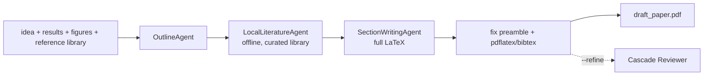
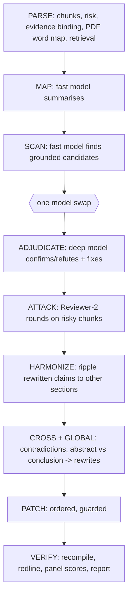

# Architecture

## Writing app

PaperOrchestra's outline, literature and refinement agents call Gemini directly (google-genai), so the model-name trick does not cover them. `plocal/llm_shim.py` monkey-patches those call sites (`utils.gemini_utils`, `utils.llm_backend_utils`, and the agent modules) to a local OpenAI-compatible endpoint, reusing the original JSON/LaTeX parsers, with retries and a streaming heartbeat. `plocal/literature_local.py` replaces Google Search + Semantic Scholar with keyword-overlap assignment from your library and reuses the original BibTeX/citation-map/synthesis code.

## Review app (Cascade Reviewer, `plocal/review_engine.py`)

Key mechanisms
* **Risk score** per chunk: over-claim lexicon density vs hedging, number density, numbers absent from the results log, undefined refs. Decides adversarial rounds (0-3).
* **Grounding**: an issue is kept only if its quote is found in the chunk (exact or fuzzy sentence match ≥0.85).
* **Retrieval** (TF-IDF over sentences + numeric-token boost): for each chunk the best related passage from other sections and from the results log; fed to the prompts as `[R1..Rn]` and used to draw comparison arcs. The model answers `compared_with` / `relation`.
* **Decision engine** (`try_patch`): no concrete fix → note; table/environment → suggestion; numbers differ → suggestion; LaTeX unbalanced or bloated → suggestion; not necessary → suggestion; else position-swapped tournament; win → applied, with signals recorded.
* **ETA**: tasks are planned with estimated token counts; prefill/decode rates are measured from streaming with an EWMA and a cross-model prior; optional tasks count 40% in the likely ETA and 100% in the worst case.
* **PDF mode** (`pdf_to_secs`): reading-order text blocks → sections; headings detected by pattern; headers/footers removed; everything becomes a suggestion.

## GUI data flow
`Monitor` (thread-safe) holds tasks, issues, changes, suggestions, relations and word geometry. The HTTP server (`plocal/review_gui.py`, stdlib) exposes `/status.json` (state), `/geo.json?since=N` (incremental word rectangles), `/layout.json`, `/page/<view>/<n>.png` (PyMuPDF render), `POST /accept/<id>` (apply a suggestion). The page polls and animates with a 60 fps loop for the reading sweep.

## Extension points
Swap/add models via env; adjust lexicons (`OVER`, `HEDGE`) and prompts in `review_engine.py`; add templates in `templates/`; add another input format by producing `(head, sections, tail)` like `pdf_to_secs`.
